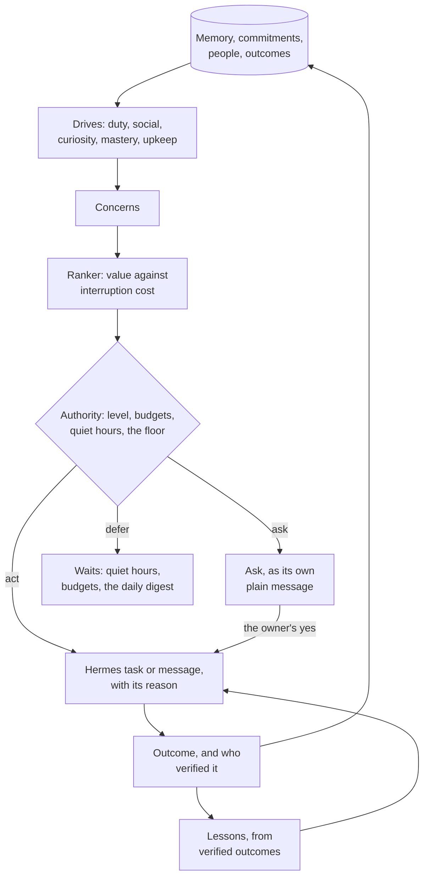

<div align="center">

<picture>
  <source media="(prefers-color-scheme: dark)" srcset="docs/branding/colonymind-primary-dark.svg">
  <source media="(prefers-color-scheme: light)" srcset="docs/branding/colonymind-primary-light.svg">
  
</picture>

**A mind for Hermes agents: persistent memory, commitments, initiative and measured autonomy.**

[Install](#get-started) · [See it work](#see-it-work) · [Evidence](#evidence) · [How it works](#how-it-works) · [Docs](docs/README.md) · [Known gaps](docs/KNOWN-GAPS.md) · [Changelog](CHANGELOG.md)

[](https://pypi.org/project/colonymind/)
[](docs/COMPATIBILITY.md)
[](docs/HERMES-ADAPTER.md)
[](https://github.com/Aevonix/ColonyMind/actions/workflows/ci.yml)
[](LICENSE)

</div>

## What it is

**Not just remember: keep promises and take the next step, within limits the owner sets.**

ColonyMind gives a personal [Hermes](https://github.com/NousResearch/hermes-agent) agent a mind. It remembers across
sessions and channels, tracks promises and people, and acts when needed, inside the owner's autonomy level,
budgets and quiet hours. It joins stock
Hermes as a plugin and memory provider, with no fork and no patches: Hermes stays the body, ColonyMind is the mind.

**Status:** research software, release 1.0.0. Hermes 0.21.3 is the supported floor for install, the first loop and
the container on Python 3.11 to 3.13; session archives need Hermes 0.21.7 or newer. A capability is
claimed only once it is measured against stock Hermes. Proto-AGI is the project's [research goal](#research-mission),
not a claim about this release.

## See it work

```bash
colonymind demo
```

No model, no keys, no network: a disposable instance with a scripted model, removed when it ends. What it prints,
shortened:

```text
[session 1] Owner: Please remember this for me: the spare key is under the blue flower pot.
$ colonymind recall --explain --as <owner> "Where did I leave the spare key?"
  1. conversation demo-1 <message>: found by keyword (rank 1) and stemmed keyword (rank 1); fused 1; not reranked (reranking is off); in the packet
[session 2] Owner: Where did I leave the spare key?
[session 2] Agent: You told me earlier: the spare key is under the blue flower pot.

[session 2] Owner: Send me the weekly report within the hour.
    ... the mind's clock moves two hours ahead, and it ticks once
Formed: Overdue: Send them the weekly report
  decided act (standard: owner -> act)
  the promise, from this conversation: "I'll send you the weekly report within the hour."

    ... a task that needs a shell asks first, in a message of its own
  | Overdue: Clean up the old build folders. Reply yes or no.
[session 3] Owner: sure, go ahead
  the sidecar: yes, a plain yes, as a reply to the ask's message: Overdue: Clean up the old build folders -> approved
[session 3] Agent: Understood: it is under way.
Done in <seconds> s. The disposable instance was removed.
```

The owner answers an ask as they would answer a person: a plain yes or no, a reply or a thumbs-up. There is no code
to type, and the model has no tool that can approve anything.

## Evidence

Paired against stock Hermes on the same model, one faculty at a time, with pre-registered gates, held-out scenarios
and every failed episode kept ([method](docs/PAIRED-AGENT-BENCHMARK.md)):

| The question (measured on a development version before this release) | Result | Verdict |
| --- | --- | --- |
| **Initiative:** the right unprompted step, once, on time, and nothing when nothing is warranted | 84 of 112 held-out scenarios; stock Hermes 51, with a heartbeat check-in 49 | demonstrated |
| **Owner outreach:** speak up when something the owner said is worth it, stay quiet otherwise | 25 of 48 against 14 for stock Hermes check-ins (p = 0.027) | demonstrated |
| **Memory:** facts, updates and corrections across sessions | stock Hermes already passes 40 of 48; ColonyMind 39 to 40 | not demonstrated: the family is too easy |
| **Affect:** feelings that lead to better decisions | 27 of 47 with and without affect | not demonstrated |

These families have not been re-run since. The [public memory benchmark](docs/PUBLIC-MEMORY-BENCHMARK.md) is
built and has no published run yet: we give every system the same memory budget and one reader prompt, use the
dataset's own judge prompts with a judge that is not the reader, and report whether the evidence reached the reader
separately from whether the answer was right.

## Get started

You need Python 3.11 to 3.13 for the sidecar (3.12 recommended), stock Hermes with `hermes` on `PATH`, and one
OpenAI-compatible chat endpoint, which Hermes already has. From Hermes 0.21.7 on, install Hermes and the adapter
on Python 3.14, in a separate environment from the sidecar.
Check [compatibility](docs/COMPATIBILITY.md) first: Hermes 0.21.3 to 0.23 is the supported range, and 0.24 is refused.
No fork, no patches, no graph database, no extra key.

```bash
uv tool install --python 3.12 colonymind
colonymind init
hermes gateway restart
```

pipx works too, and where the adapter is already in Hermes' environment, `hermes memory setup`, then
`colonymind-memory`, runs the same init. The sidecar gets an environment of its own; only the small adapter package
goes into Hermes' Python. `init` asks who you are and where you talk to the agent, its name and values, a time zone
and an autonomy level (default `suggest`), points ColonyMind at the model endpoint Hermes uses and starts the sidecar
as a user service; it never restarts a running gateway. `--embed-url auto` finds your endpoint's embeddings route.
Where the endpoint has none, `colonymind init --embed-url local` runs a pinned embedding model inside the sidecar
instead: it needs the `colonymind[vectors]` extra (`uv tool install --force --python 3.12 'colonymind[vectors]'`, which
brings PyTorch and the transformers 4.51 or later its models need), and init downloads the model once into the
instance directory (`Qwen/Qwen3-Embedding-0.6B`, about 1.2 GB). A machine under 8 GB of memory is offered none;
adding `--embed-model Qwen/Qwen3-Embedding-0.6B` takes it anyway. Its files stay in
`<instance>/models` after a switch to an endpoint or an uninstall, until you delete them. Without either, recall
matches keywords only, and init says so.

> [!IMPORTANT]
> **ColonyMind becomes your Hermes memory provider.** Hermes runs its built-in memory plus at most one external
> provider. `init` names the provider it replaces, and `colonymind init --uninstall` puts it back. It also sets
> `plugins.hook_callback_timeout: 0`, which is Hermes-wide: every plugin's callbacks run inline
> ([the full list](docs/INSTALL.md#install)).

**In a container.** The image `ghcr.io/aevonix/colonymind` is stock Hermes' own published image, pinned by digest and
patched nowhere, with ColonyMind beside it; [`docker/compose.yml`](docker/compose.yml) runs it with your handles and
one model endpoint ([the container guide](docs/INSTALL.md#container)).

**Check it.** `colonymind doctor` checks Hermes, the adapter, the keys, the worker profile, the service and the
sidecar, prints a remedy for each failure and warns while recall is keyword-only or has no calibrated cutoff. Then
tell the agent a harmless fact in one session and ask for it in a new one; in your own chat Hermes shows
"recalled N" (never in a contact's chat, and never to the model). `colonymind recall "<question>" --as <person>
--explain` shows why each candidate was kept or left out.

**Watch the mind.**

```bash
colonymind mind status      # on or off, level, queues, breaker, budgets
colonymind mind concerns    # what is on its mind
colonymind mind log         # what it did, newest first, with the ids 'why' takes
colonymind mind why <id>    # one decision: drive, evidence, decision, Hermes task, outcome
colonymind mind off         # stop every effect at once; works with the model endpoint down
```

At `suggest` the mind does internal work, sends what you asked for and keeps the rest for the daily digest;
`colonymind mind level standard` lets it message you within budgets and quiet hours.

**Coming from another memory provider**, **update** (`uv tool upgrade colonymind`, `colonymind upgrade`,
`hermes gateway restart`) and **uninstall** are in the [install guide](docs/INSTALL.md). Existing Hermes history
can be imported as quotations at init or later ([history import](docs/HERMES-HISTORY-IMPORT.md)). Stuck? See
[troubleshooting](docs/TROUBLESHOOTING.md).

## What you get

| | What the owner sees | Docs |
| --- | --- | --- |
| **Memory in their words** | A fact or correction told on one channel used on another, after a model swap too, as the person's own words with their source. Digests stay in the person's language. | [recall](docs/RECALL-HYBRID.md), [claims](docs/SOURCE-CLAIMS.md) |
| **Recall that explains itself** | Keyword, stemmed, vector, claim-key and date-window lanes; "last week" read as the span it names, and the agent's search can name the span itself; `--explain` says why each candidate was kept. | [tracing](docs/RECALL-HYBRID.md#tracing-a-recall), [time](docs/RECALL-HYBRID.md#recall-and-time) |
| **What memory holds** | `colonymind memory inventory <who>` lists each claim held about a person with its state, words and source; `colonymind memory history <claim>` shows what it replaced and what replaced it; `colonymind memory reextract` forms older history again under the current extractor. | [inventory](docs/SOURCE-ANNOTATIONS.md#the-memory-inventory), [re-extraction](docs/SOURCE-CLAIMS.md#re-extraction) |
| **Commitments** | "I'll send it by 3pm" tracked with who owes it, to whom and when; "make it Friday" moves that item. | [the loop](docs/MIND.md#the-loop) |
| **Work in view** | The turn-start work list shows Hermes background processes, cron, kanban and reported workers. Optional job watch reports stuck or over-limit work and broken dependencies, then reports recovery. | [work](docs/WORK.md), [job watch](docs/JOB-WATCH.md) |
| **People** | One person across verified handles, recall scoped by person, and a permission per contact: `auto`, `ask` or `never`. | [people](docs/RELATIONSHIPS.md), [contacts](docs/SOCIAL-STATE.md) |
| **Initiative and outreach** | Drives raise concerns: an overdue promise, a question worth researching. A message to the owner quotes its reason; "not now" or "stop checking in" steers it. | [outreach](docs/MIND.md#outreach-to-the-owner) |
| **Asks like a person** | Each ask is its own plain message (at most three a day, the rest in one list). An approval for work the owner started follows the reply to their request, apart from it; background asks wait for a pause, and another fresh unanswered ask or message still keeps a new ask back. A yes, a reply or a thumbs-up answers it. Where an ask offers it, "always" stops the asking for exactly that kind of work until the owner takes it back (`colonymind mind allows`). Only the owner's own answer teaches the mind. | [asks](docs/MIND.md#asks), [standing allows](docs/MIND.md#standing-allows) |
| **Wishes, typed** | The agent can ask for a capability it lacks, from its own failed tasks and the owner's failed or corrected work; a yes adopts a fixed set of steps shown in full, never access. | [wishes](docs/MIND.md#wishes) |
| **Instinct** | Quick decisions run through local tiers measured in shadow and promoted only on evidence; no model tier can approve, grant or widen anything. | [Instinct](docs/DECISIONS.md), [Hermes gates](docs/HERMES-GATES.md) |
| **Privacy** | Secrets are sealed out of memory; each key writes only as whom it is bound to; forgetting follows lineage, the person's digest included. | [secrets](docs/SECRETS.md), [credentials](docs/CREDENTIALS.md), [erasure](docs/RELATIONSHIPS.md#source-erasure) |
| **Owner console** | `colonymind console` opens read-only pages on this machine, behind a one-time link: the mind's state, concerns, log and asks, health, the reports, the recall check and the memory inventory. Its one control is the off switch; it never answers an ask. | [console](docs/CONSOLE.md) |
| **Other agents, over MCP** | A read-first endpoint (`POST /v1/mcp`) for a coding agent or an assistant, bound to a credential of its own: recall, open commitments, the mind's status, why and asks, and one write, a note kept as that credential's own evidence. Unmeasured in other hosts. | [MCP](docs/MCP.md) |
| **Reports** | What each faculty did and its off switch, how asks went, how far each decision tier is trusted, what the model calls cost by lane and what the claim extractor formed, in counts only (`colonymind report usage`, `colonymind report claims`). | [reports](docs/MIND.md#reports), [usage](docs/FUNCTION-ROUTING.md#usage-model-calls-by-lane) |
| **Media** | Images, audio, PDFs and short video kept as originals, with descriptions and transcripts linked back. | [images](docs/SOURCE-IMAGES.md), [audio](docs/SOURCE-AUDIO.md), [documents](docs/SOURCE-DOCUMENTS.md), [video](docs/SOURCE-VIDEOS.md) |

## How it works

**Every turn.** Before a reply, recall assembles memory for the message being answered, synchronously: lexical lanes
in SQLite, semantic search over a LanceDB index when an embedding endpoint is set, and an optional reranker. With a
cutoff calibrated on your own questions ([how](docs/RECALL-HYBRID.md#returning-no-useful-memory)), an unrelated
question gets no memory rather than noise. The context is fitted to Hermes' inline allowance and the system prompt
stays stable, so the prompt cache holds. After the reply, the turn goes through a durable outbox and is stored as
source evidence; claims, commitments and appraisals are extracted in the background. The original is never rewritten.

**The mind** runs every minute:



| Level | Internal work | Messages to the owner | Messages to contacts | External effects |
| --- | --- | --- | --- | --- |
| `off` | nothing runs | nothing | nothing | nothing |
| `suggest` | acts | only what the owner asked for; the rest waits for the daily digest | asks | asks |
| `standard` | acts | acts, within budgets and quiet hours | per the contact's permission | asks |
| `trusted` | acts | acts, within budgets and quiet hours | per the contact's permission | acts |

Moving money, irreversible deletion, credential changes and bulk messages ask at every level unless the owner granted
that exact kind of call (a standing grant, or "always" on its ask), and a task that needs a shell, code or a browser
always asks. What decides is what an action does (the tool and its target), never how it was worded
([the floor](docs/MIND.md#the-floor)). Details: [architecture](docs/ARCHITECTURE.md), [the mind](docs/MIND.md),
[Hermes adapter](docs/HERMES-ADAPTER.md).

**What it costs.** Before each reply, one recall request, which Hermes waits for up to its prefetch deadline, and
in the owner's chat while an ask is open, one read of their message (at most 1.5 seconds). Every model request
carries ColonyMind's tool schemas (about 5,000 characters in all) and its prompt text (about 1,750 characters in a
typical owner session, at most 3,200); neither changes between turns, so the prompt cache keeps them. After each
reply, extraction makes a few model calls off the reply path. The mind's own calls stop at 200,000 tokens a day by
default, and its tasks run as Hermes workers, at most 4 an hour and 2 at once. `colonymind report usage` shows what
your own instance spends: calls, tokens and latency per task and role, and what memory costs per captured message.

## ColonyMind and other Hermes memory options

Hermes allows one external memory provider next to its built-in memory, so ColonyMind replaces a memory provider
rather than adding to one.

| | Hermes built-in memory | A memory-only provider | ColonyMind |
| --- | --- | --- | --- |
| Hermes slot | always on | the one external provider | the one external provider |
| Recall computed for the current message, before the reply | notes are always in the prompt; session search runs when the model calls it | varies | yes, synchronously ([recall](docs/RECALL-HYBRID.md)) |
| What recall returns | notes and session hits | varies | the person's own words, with their source ([claims](docs/SOURCE-CLAIMS.md)) |
| Local by default | yes | varies | yes, on the endpoint Hermes already uses ([install](docs/INSTALL.md)) |
| Tracks promises and deadlines | no | varies | yes ([the loop](docs/MIND.md#the-loop)) |
| Acts unprompted, within limits the owner sets | scheduled jobs you set up | no | yes ([authority](docs/MIND.md#the-floor)) |
| Unprompted actions ask the owner first | no unprompted actions | no unprompted actions | yes; money, irreversible deletion, credential changes and bulk messages ask unless the owner granted that exact kind ([the floor](docs/MIND.md#the-floor)) |
| Forgetting follows lineage to derived data | not applicable | varies | yes, within its stores ([erasure](docs/RELATIONSHIPS.md#source-erasure)) |
| Measured against stock Hermes, paired | the baseline | varies | yes ([evidence](#evidence)) |

Hermes' own command approvals apply in every column.

## Configuration at a glance

Settings live in `colonymind.yaml` in the instance directory (`~/.colonymind` by default); the agent's name, values,
boundaries and time zone are in `identity.yaml` beside it ([full reference](docs/INSTALL.md#configure)).

| Key | What it controls | Default |
| --- | --- | --- |
| `mind.enabled` | the off switch | `true` |
| `mind.autonomy` | `off`, `suggest`, `standard` or `trusted` | `suggest` |
| `mind.faculties` | one switch per faculty | on, except `skills` and `affect_rules` |
| `mind.budgets` | messages a day (owner, outreach, contacts), tasks an hour, the mind's tokens a day | 3, 3, 5; 4; 200,000 |
| `mind.quiet_hours` | when unprompted owner messages wait | `22:00-07:00` |
| `mind.digest_hour` | local hour after which the daily digest goes out | `8` |
| `mind.asks` | ask messages a day, the one reminder, the pause before an ask enters a conversation, the yeses in a row before an offer to stop asking | 3; 24 h; 10 min; 3 |
| `router.embed_url`, `router.rerank_url` | embedding and reranking endpoints, local or remote | none: keyword recall, no reranker |
| `router.embed_provider` | `endpoint` (at `router.embed_url`) or `local` (a pinned model the sidecar runs itself) | `endpoint` |
| `instinct` | decision providers for the quick decisions | none: every decision keeps its own path |
| `credentials` | the platforms each key may write the owner from | set by `init` |

Job watch runs only when invoked, usually by an optional five-minute timer. Its defaults:

```yaml
watch:
  enabled: true
  hermes_home: ~/.hermes
  stuck_minutes: 30
  repeat_failures: 3
  repeat_window_hours: 24
  health_timeout_s: 10
  dependency_failure_passes: 2       # consecutive failed passes before opening
  notice_timeout_s: 30              # kill sender group; retry timeouts hourly
  notice_command: []                 # argv; message on stdin; unset: queue no notices
  downloads: {url: ""}
  endpoints: []
  tmux: true
```

## Operating it

| | How |
| --- | --- |
| Health | `colonymind doctor`; the sidecar's `/v1/host/health` answers `ok` or `degraded`, with the reasons in words |
| Job watch | `colonymind watch --once`; `colonymind watch --list` reads open findings. Optional timer templates in `scripts/launchd/` and `scripts/systemd/` run independently of the sidecar ([install](docs/INSTALL.md#optional-job-watch-timer)) |
| Failure counts | The owner view of `GET /v1/mind/status` includes `health_counters` for loop stalls, failed context reads, dropped writes and incomplete mind tasks |
| Stop everything | `colonymind mind off` (holds across restarts); `colonymind mind on` |
| Logs | `service/sidecar.log` in the instance directory |
| What the model calls cost | `colonymind report usage --since 7d` (`--json` for the same numbers as data) |
| What the claim extractor formed | `colonymind report claims --since 7d`: claims by extraction version, and those whose subject an earlier message named ([claims](docs/SOURCE-CLAIMS.md#corrections-changes-and-conflicts)) |
| A view in the browser | `colonymind console`: read-only pages on loopback, with the off switch ([console](docs/CONSOLE.md)) |
| Backup and restore | `colonymind backup` (`--encrypt` for a passphrase) and `colonymind restore` ([recovery](docs/SOURCE-MEMORY-RECOVERY.md)) |
| A live replica | `colonymind twin init`, a read-only copy on a second machine ([the memory twin](docs/TWIN.md)) |

## Status and roadmap

**Known gaps**, in short ([full list](docs/KNOWN-GAPS.md)):

- Forgetting follows lineage within ColonyMind's stores; unlinked older data, Hermes' own transcripts and backups are
  not yet covered.
- Replies to outreach are read by fixed phrase tables (their model tiers run only in shadow), so unusual wording
  can be missed.
- Lessons reach new work by shared words, so a request worded differently can miss a relevant lesson.
- Opinions that help and improving a recurring failure on its own are not yet shown.

| Phase 1 outcome | What must work | Status |
| --- | --- | --- |
| Remember across models and channels | apply a fact or correction from one conversation in another after a model swap | implemented; the paired family is saturated |
| Maintain quality | keep low-value material out; handle contradictions, corrections and forgetting | implemented; forgetting outside ColonyMind's stores is open |
| Continue work during conversation | inspect, redirect or cancel a task from another channel | implemented |
| Use a coherent identity | show how a stored preference or opinion changes behavior | partly; opinions not demonstrated |
| Recall beyond text | recover information from supported media and reopen the original | implemented |
| Take useful initiative | notice an opportunity or overdue commitment and follow it through | demonstrated (initiative, outreach) |
| Improve a recurring failure | diagnose, evaluate a change on an independent task, show a benefit | open |
| Install, upgrade and recover | set up a private agent and recover with memory, tasks and permissions intact | implemented |

**Next.** Re-run every family on this release; publish the public memory benchmark; gate the harder memory family against
stock Hermes; promote Instinct tiers only where the bake-off supports them; complete forgetting across host
transcripts and backups. **Phase 2**, once Phase 1 is validated: improve how the agent selects, evaluates and keeps
changes to its skills, prompts, retrieval and non-core code, and show that this process gets better over cycles.

### Research mission

We use **Proto-AGI** for the goal of a persistent agent that remembers what matters, revises its opinions on
evidence, keeps commitments, takes useful initiative and improves through experience, while its owner can keep
talking to it, correct it and inspect the evidence behind its actions. Autonomy means initiating useful work within
the authority the owner grants. Neither another model call nor a model's claim of success demonstrates learning:
improvements need independently observed outcomes. Continuity lives outside model weights, so models can change and
serve different roles, provided each passes qualification for its work.

## Documentation

Every guide, by task: [the documentation index](docs/README.md). The most used:
[install and update](docs/INSTALL.md), [troubleshooting](docs/TROUBLESHOOTING.md), [job watch](docs/JOB-WATCH.md),
[the Hermes adapter](docs/HERMES-ADAPTER.md), [the mind](docs/MIND.md), [recall](docs/RECALL-HYBRID.md),
[the paired benchmark](docs/PAIRED-AGENT-BENCHMARK.md), [credentials](docs/CREDENTIALS.md) and
[known gaps](docs/KNOWN-GAPS.md).

## Development

```bash
python -m pip install -e './sidecar[dev]'
cd sidecar
python -m pytest -q tests colonymind
```

`tests/hermes_adapter` checks the built packages against stock Hermes on Python 3.11, 3.12 and 3.13, and daily
checks repeat that against Hermes' latest release and its development branch. One branch per change, with a failing
test before the fix; measure a new capability with the paired benchmark before claiming it; keep private data,
credentials and deployment configuration out of commits. See [CONTRIBUTING](CONTRIBUTING.md), the
[security policy](SECURITY.md) and the [code of conduct](CODE_OF_CONDUCT.md).

## License and brand

[MIT](LICENSE); optional dependencies keep their own licenses. ColonyMind is a project of
[Aevonix Research](https://aevonix.com); see the [brand guide](https://aevonix.com/branding) and the
[repository asset notes](docs/branding/README.md).
The MIT license covers the code; the name and logo are covered by [docs/branding/README.md](docs/branding/README.md).
